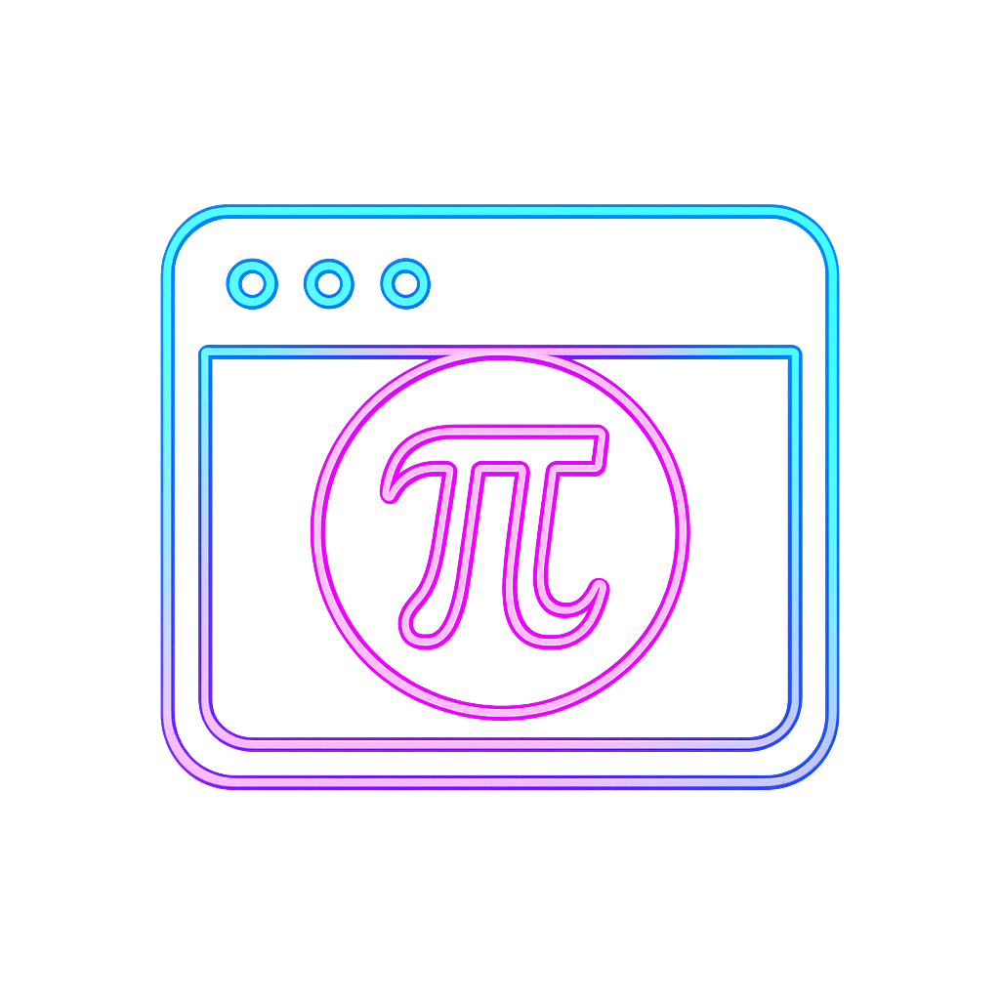

#  PI-Game-Extension

> **A retro arcade browser extension to test your memory of PI!**  
> 
> 
> 

---

**PI-Game-Extension is a fun and challenging browser extension where you test how many digits of PI you can remember, compete for high scores, and unlock achievements in a retro arcade style.**

---

<!-- Donation Buttons -->
<div align="center" style="margin-bottom: 18px;">
  <a href="https://www.paypal.com/paypalme/IrisSmile" target="_blank" style="display:inline-block;margin:4px;">
    
  </a>
  <a href="https://ko-fi.com/IrisSmile" target="_blank" style="display:inline-block;margin:4px;">
    
  </a>
  <a href="https://www.buymeacoffee.com/IrisSmile" target="_blank" style="display:inline-block;margin:4px;">
    
  </a>
</div>

---

## 📁 Project Structure

```
PI-Game-Extension/
│
├── assets/
│   ├── pi-logo.png
│   ├── pi16.png
│   ├── pi48.png
│   ├── pi128.png
│   ├── sound/
│   │   ├── correct.mp3
│   │   ├── wrong.mp3
│   │   └── gameover.mp3
│   └── (other images, icons, screenshots)
│
├── popup.html
├── popup.css
├── popup.js
├── manifest.json
│
├── js/
│   ├── modeBase.js
│   ├── modeNormal.js
│   ├── modeTimed.js
│   ├── modeStreak.js
│   ├── modeSpeedrun.js
│   ├── achievements.js
│   ├── dailyChallenge.js
│   ├── trivia.js
│   ├── facts.js
│   ├── settings.js
│   ├── ui.js
│   └── sound.js
│
├── README.md
└── LICENSE
```

- **assets/**: Images, icons, and sound files.  
  **New:** Extension icons (`pi16.png`, `pi48.png`, `pi128.png`) are now included and referenced in the manifest.
- **popup.html / popup.css / popup.js**: Main extension popup UI and logic.
- **manifest.json**: Chrome/Edge extension manifest.  
  **New:** Now includes the `icons` field for extension branding.
- **js/**: All JavaScript modules for game logic, modes, features, and utilities.
- **README.md**: This file.
- **LICENSE**: Open source license.

---

## 🚀 Features

- 🎮 **Arcade-style UI** with neon colors and retro fonts
- ⏱ **Normal, Timed, Streak, and Speedrun Modes**: Play at your own pace, race against the clock, keep a streak alive, or type as many digits as possible in 30 seconds!
- 🏅 **Achievements & Badges**: Unlock badges for reaching digit milestones (10, 25, 50, 75, 100)
- 📈 **Score Tracking**: Your highest score, streak, and speedrun high score are saved locally
- 🔥 **Streak Counter & Countdown**: See how many digits you get right in a row and race against a 5-second timer in Streak mode
- 🏆 **Achievements Modal**: View all badges and your progress at any time
- 🎯 **Daily & Weekly Challenge**: Reach a new random digit target every day and week!
- 💬 **Motivational Messages**: Get encouragement as you play
- 🧠 **Fun PI Facts**: Learn a random PI fact after each game over or win
- ❓ **PI Trivia**: Test your knowledge with PI-related trivia questions!
- 🎉 **Confetti & Emoji Feedback**: Celebrate your progress with effects and emoji
- 📤 **Share Score**: Copy your score and achievements to share with friends
- ⚙️ **Settings**: Toggle sound, animations, and switch between neon and dark themes
- 📴 **Offline Ready**: All features work without internet
- 🛡️ **No Pasting Allowed**: For fair play, pasting is disabled in the digit input.
- 🖼️ **Extension Icon**: Custom extension icons are now included and shown in the browser.

---

## 🕹 How It Works

1. Open the extension popup to start the PI Game.
2. Choose a mode: **Normal**, **Timed**, **Streak**, or **Speedrun**.
3. Type the digits of PI one by one.
4. The extension checks each digit as you type.
5. The game ends when you enter a wrong digit—your score is displayed.
6. Unlock achievements, see your best score, and learn fun facts and trivia!

---

## 🛠 Getting Started

1. **Clone or download** this repository.
2. **Load the extension** into your browser (e.g., Chrome or Edge):
   - Go to `chrome://extensions/`
   - Enable "Developer mode"
   - Click "Load unpacked" and select this folder
3. **Click the extension icon** to open the PI Game popup and start playing!

---

## 📸 Screenshots

<!--
Add your screenshots below. Example:


-->

<!-- Screenshot placeholders -->


---

## 🤝 Contributing

Pull requests and suggestions are welcome!  
See the [GitHub repo](https://github.com/SawsanDaban/PI-Game-Extension) for details.

---

## ☕ Support

If you enjoy the PI Game, consider [donating a coffee](https://www.buymeacoffee.com/IrisSmile) to support development!

---

## 📄 License

Open source. See [LICENSE](LICENSE) for details.

---

## 🛠️ Next Step

- **Enable and polish sound effects** for correct, wrong, and game over events (see `sound.js`).
  - Integrate the sound system with all game modes.
  - Add volume control and mute/unmute toggle in settings.
- **Integrate sound settings** so users can toggle sound on/off in the settings menu.
  - Ensure sound respects the user's preference at all times.
- **Add more visual feedback** (animations, effects) for correct/wrong/game over.
  - Enhance confetti and emoji feedback.
  - Add subtle shake or flash for wrong input.
- **Improve accessibility** (keyboard navigation, ARIA labels, color contrast).
  - Ensure all interactive elements are keyboard accessible.
  - Add ARIA labels and roles for screen readers.
  - Review and improve color contrast for all themes.
- **Add more achievements and badges** for advanced milestones.
  - Include achievements for perfect games, streaks, trivia, and sharing.
  - Display achievement notifications in-game.
- **Implement statistics/history page** to track user progress over time.
  - Show charts or tables of scores, streaks, and challenges completed.
  - Allow users to reset their stats if desired.
- **Add cloud sync and backup/import features** for scores and settings.
  - Allow users to export/import their progress.
  - Optional: sync with a cloud account for backup.
- **Expand localization/multi-language support**.
  - Add language selector in settings.
  - Translate UI, achievements, facts, and trivia.
- **Add more PI trivia and fun facts**.
  - Expand the trivia and fact database.
  - Rotate facts and trivia more frequently.
- **Polish UI for mobile and small screens**.
  - Make popup and modals responsive.
  - Test on various device sizes.

---

## 🧭 Planned Features

- **Sound Effects**: Fully integrated, user-controllable sound for all actions.
- **Advanced Achievements**: More badges for expert players and special actions.
- **Statistics Page**: Visualize your progress and history.
- **Cloud Sync/Backup**: Never lose your scores or settings.
- **Localization**: Play in your preferred language.
- **Accessibility**: Full keyboard and screen reader support.
- **UI Polish**: Even smoother experience on all devices.

---
